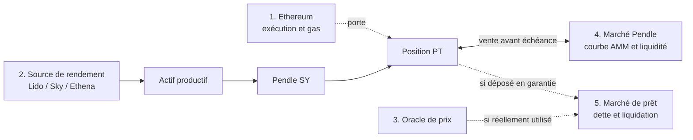

# Comprendre la track Belem Capital

Fiche de référence pour expliquer le problème, les actifs, les cinq étages de risque et le rôle de notre site. Le site étudie [dix positions](../data/positions.json) ; les trois marchés PT ci-dessous ne sont que des exemples. Les scénarios et chiffres de perte ne sont pas des prévisions.

## 1. La question posée par la track

Une position DeFi paraît parfois simple : « je possède un token ». En réalité, sa valeur et la possibilité de sortir dépendent de plusieurs contrats, actifs, marchés et parfois d'un prêt. La track demande de **découvrir ces dépendances**, d'estimer **la perte possible si l'une d'elles est touchée**, puis de comparer **rester exposé** et **sortir en payant les coûts d'exécution**. Le [brief Belem Capital](../BelemCapital_EPFL-Hackathon_DeFi-Risk-Dependency-Challenge_EN_v1.pdf) donne le PT comme exemple ; il évalue la découverte des dépendances (30 %), l'estimation défendable de l'impact (30 %), l'utilité de la décision (25 %) et la démonstration avec des données réelles (15 %).

**L'idée à retenir :** on ne peut pas conclure « sortir » à partir d'une baisse hypothétique du PT. Il faut savoir **ce qui cause la baisse**, **ce qu'on reçoit en vendant**, **si cet actif reçu garde le même risque**, et **combien coûte réellement la route complète vers une exposition différente**.

## 2. Le vocabulaire : qu'est-ce que l'on possède ?

| Terme | Explication simple | Exemple dans le projet |
| --- | --- | --- |
| Blockchain / chaîne | Registre et environnement où les contrats exécutent les opérations. | Ethereum ; l'ETH sert aussi à payer le *gas*, c'est-à-dire les frais d'exécution. |
| Token | Unité numérique inscrite sur la chaîne. Sa valeur dépend des droits qu'elle représente : les tokens ne sont pas tous des « monnaies ». | ETH, USDS, USDe, stETH, sUSDS, sUSDe, PT. |
| Actif productif | Token dont la quantité ou la valeur en actif de référence peut évoluer avec un rendement. | wstETH, sUSDS, sUSDe. |
| Actif de référence (*accounting asset*) | Unité dans laquelle Pendle exprime normalement la valeur à échéance du PT. | stETH pour le marché wstETH ; USDS pour le marché sUSDS ; USDe pour le marché sUSDe. |
| SY (*Standardized Yield*) | Adaptateur Pendle qui uniformise l'interaction avec l'actif productif. | Le contrat SY associé à chacun des trois marchés. |
| PT (*Principal Token*) | Droit sur la partie « principal » de l'actif productif, à une date d'échéance. | PT-sUSDe du 26 novembre 2026. |
| YT (*Yield Token*) | Droit au rendement variable de l'actif productif jusqu'à cette échéance. | YT-sUSDe correspondant ; notre site suit le PT, pas le YT. |
| AMM | Marché automatisé où le prix dépend d'une courbe et de la liquidité disponible. | Marché Pendle PT/SY, utilisé pour vendre un PT avant échéance. |
| Oracle | Mécanisme qui transmet un prix ou un taux à un contrat. | Un oracle de PT peut être utilisé par un prêteur ; il faut vérifier lequel pour une position donnée. |
| Collatéral | Actif déposé en garantie d'une dette. | Un PT peut être déposé dans certains marchés de prêt ; ce n'est pas le cas d'un PT simplement détenu dans un wallet. |

Le fonctionnement [PT](https://docs.pendle.finance/pendle-v2/ProtocolMechanics/YieldTokenization/PT), [SY](https://docs.pendle.finance/pendle-v2/ProtocolMechanics/YieldTokenization/SY), [YT](https://docs.pendle.finance/pendle-v2/ProtocolMechanics/YieldTokenization/YT) et [AMM](https://docs.pendle.finance/pendle-v2/ProtocolMechanics/LiquidityEngines/AMM) est décrit par Pendle. Un PT a **normalement** une valeur de remboursement de 1 unité de son actif de référence à échéance, **pas** 1 token productif et **pas** nécessairement 1 dollar. Ce résultat dépend aussi de la valeur du sous-jacent : [Pendle décrit des cas de rendement négatif](https://docs.pendle.finance/pendle-v2/ProtocolMechanics/NegativeYield) où le remboursement du PT est inférieur à cette unité théorique.

### Exemple concret : de l'ETH au PT du marché wstETH

```text
ETH → staking chez Lido → stETH → emballage en wstETH
                                    ↓
                              adaptateur SY Pendle
                                    ↓
                        séparation en PT + YT
                                    ↓
                  notre position : le PT du marché wstETH
```

Le stETH représente de l'ETH staké via Lido. Sa quantité peut évoluer avec les récompenses et pénalités. Le wstETH représente le même système sous une forme dont la **quantité** ne change pas lors des mises à jour de rendement ; sa valeur en stETH évolue. Le PT de ce marché a **stETH** comme actif de référence : à échéance, on vise normalement 1 stETH de valeur en wstETH par PT, et non 1 wstETH entier. Acheter un PT avant échéance revient à acquérir ce droit à un prix de marché ; le prix peut bouger et la vente anticipée dépend de l'AMM. Notre interface abrège ce marché en « PT-wstETH », tandis que le symbole du token relevé par Pendle est **PT-stETH-30DEC2027** : il faut distinguer le nom affiché, le sous-jacent et le véritable symbole du contrat. [Sources : Lido](https://docs.lido.fi/guides/lido-tokens-integration-guide/), [Pendle PT](https://docs.pendle.finance/pendle-v2/ProtocolMechanics/YieldTokenization/PT), [graphe du marché](../data/graphs/pt-wsteth-30dec2027.json).

## 3. Les protocoles présents dans nos exemples

| Protocole / composant | Son travail | Actifs rencontrés | Risques à rechercher |
| --- | --- | --- | --- |
| **Ethereum** | Exécute les contrats et règle les transactions. | ETH pour le gas ; contrats des autres protocoles. | Congestion, frais élevés, retard de finalité, erreur de transaction ou de nœud RPC. |
| **Lido** | Organise le staking d'ETH et émet les tokens qui représentent la position stakée. | stETH et wstETH. | Pénalité des validateurs, défaut de contrat ou de gouvernance, retrait lent, décote du stETH face à l'ETH sur un marché. |
| **Sky** | Émet l'USDS et propose le mécanisme d'épargne qui produit sUSDS. | USDS et sUSDS. | Décrochage de l'USDS par rapport au dollar, risque de réserves ou de gouvernance, risque du coffre sUSDS ; taux d'épargne variable. |
| **Ethena** | Émet l'USDe, dollar synthétique adossé à une stratégie et à divers actifs ; propose le dépôt en sUSDe. | USDe et sUSDe. | Qualité des actifs et couvertures, contreparties/custody, taux de financement, liquidité et cours de l'USDe, délai de retrait du sUSDe. |
| **Pendle** | Transforme le rendement en PT et YT ; fournit le marché PT/SY. | SY, PT, YT. | Contrats et routage, taux de conversion, prix PT, courbe de l'AMM, profondeur du marché et frais de vente. |
| **Oracle**, si utilisé | Fournit à un autre contrat un prix ou un taux qu'il utilise pour prendre une décision. | Prix PT, prix d'un collatéral, taux de conversion. | Valeur erronée, donnée ancienne, manipulation, mauvaise configuration. |
| **Prêteur**, si utilisé | Accepte le PT en garantie et permet d'emprunter. | PT en collatéral, dette en autre actif. | Liquidation quand la garantie n'est plus suffisante, intérêts de dette, paramètres du marché. |

Sources : [Lido et ses risques](https://docs.lido.fi/prd/), [Sky USDS](https://developers.skyeco.com/protocol/tokens/usds/) et [sUSDS](https://developers.skyeco.com/protocol/tokens/susds/), [Ethena USDe et ses mécanismes](https://docs.ethena.fi/) et [sUSDe](https://docs.ethena.fi/technical-design/staking-usde), [Pendle AMM](https://docs.pendle.finance/pendle-v2/ProtocolMechanics/LiquidityEngines/AMM). Ethena ne repose pas uniquement sur un unique couple « ETH détenu + ETH vendu à découvert » : sa documentation décrit plusieurs types d'actifs et de stratégies.

### Les trois chemins étudiés par notre site

| Marché Pendle | Avant Pendle | Actif de référence du PT | Protocole d'origine |
| --- | --- | --- | --- |
| Marché wstETH, token PT-stETH-30DEC2027 | ETH → stETH → wstETH | stETH | Lido |
| PT-sUSDS, 26 novembre 2026 | USDS → dépôt dans sUSDS | USDS | Sky |
| PT-sUSDe, 26 novembre 2026 | USDe → dépôt dans sUSDe | USDe | Ethena |

USDS et USDe cherchent une référence au dollar, mais ce sont des mécanismes différents : USDS est le stablecoin de Sky ; USDe est le dollar synthétique d'Ethena. Le fait qu'un token soit exprimé en « dollar » n'en garantit pas le prix à 1 USD. De même, un rendement en USDe ou en USDS ne garantit pas un rendement en dollars réels. [Sources : Sky](https://developers.skyeco.com/protocol/tokens/usds/), [Ethena](https://docs.ethena.fi/).

## 4. Les cinq étages de la track

Les « cinq étages » sont cinq **familles de dépendances à examiner**, pas cinq contrats nécessairement traversés dans cet ordre. Le graphe réel peut se ramifier. Un PT seulement détenu n'a pas automatiquement de dette ni d'oracle de liquidation. [Brief original](../BelemCapital_EPFL-Hackathon_DeFi-Risk-Dependency-Challenge_EN_v1.pdf).



| Étage | Pourquoi il compte | Incident possible → effet | Ce que l'on peut vérifier / faire |
| --- | --- | --- | --- |
| **1. Chaîne de règlement** | Tous les contrats et échanges étudiés sont sur Ethereum. | Réseau encombré ou incident de finalité → vente, remboursement ou ajustement de dette retardés ; gas plus cher. | Comparer l'état de la chaîne sur plusieurs sources et le gas ; garder l'ETH nécessaire aux opérations. Un RPC défaillant ne signifie pas forcément qu'Ethereum est en panne. |
| **2. Source de rendement et protocole d'origine** | Elle détermine l'actif qui soutient économiquement le PT. | Perte de réserves, pénalité de staking, décrochage d'un stablecoin ou défaut de contrat → actif productif affaibli, puis valeur du PT potentiellement touchée. | Examiner prix de marché **et** valeur/conditions de remboursement, incidents et restrictions ; construire un scénario de perte chiffré. |
| **3. Oracle** | Il fournit un prix à une application qui en dépend, surtout un marché de prêt. | Prix faux ou trop ancien → mauvaise valorisation, seuil de liquidation franchi artificiellement ou trop tard. | Identifier le feed effectivement utilisé, contrôler son horodatage et comparer à des prix négociables. La simple présence d'un prix USD dans notre site n'établit pas une dépendance à un oracle on-chain. |
| **4. Marché PT et courbe AMM** | C'est la voie de vente avant l'échéance. | Retraits de liquidité ou ventes massives → moins de tokens reçus, glissement et parfois impossibilité de vendre à prix acceptable. | Obtenir une cotation pour **la quantité réelle**, examiner la profondeur et les frais, comparer à l'attente jusqu'à échéance si le remboursement reste crédible. |
| **5. Marché de prêt** | Il compte si le PT garantit une dette. | Baisse du PT, dette qui grossit ou oracle erroné → liquidation de tout ou partie de la garantie. | Lire le marché précis, sa dette et son facteur de santé ; réduire la dette ou ajouter une garantie si l'on choisit de protéger cette position. |

L'[AMM de Pendle](https://docs.pendle.finance/pendle-v2/ProtocolMechanics/LiquidityEngines/AMM) échange directement PT et SY ; sa courbe dépend du rendement implicite et de la date d'échéance. L'[oracle de Pendle](https://docs.pendle.finance/pendle-v2-dev/Oracles/OracleOverview) et les [feeds Chainlink](https://docs.chain.link/data-feeds/overview) sont des exemples de mécanismes de prix, pas la preuve qu'un marché de prêt donné les utilise. Les [liquidations décrites par Aave](https://aave.com/help/borrowing/liquidations) illustrent le risque général d'un emprunt collatéralisé ; notre site ne prétend pas qu'un des trois PT est actuellement déposé sur Aave.

### Pourquoi un problème se propage

Exemple **hypothétique** sur Ethena : un problème sur une contrepartie ou les actifs qui soutiennent USDe accroît le doute sur le remboursement d'USDe → le prix négocié d'USDe peut baisser → la valeur en USD du sUSDe peut baisser, même si chaque part sUSDe représente toujours des USDe → le PT-sUSDe et son marché peuvent être touchés → si ce PT est aussi en garantie d'une dette, son cours ou son oracle peuvent déclencher une liquidation. Les flèches « peut » ne donnent ni un pourcentage de perte ni une certitude : il faut mesurer chaque transmission. [Risque de garde Ethena](https://docs.ethena.fi/protocol-overview/risks/custodial-risk), [PT en collatéral](https://docs.pendle.finance/pendle-v2-dev/Oracles/PTAsCollateral).

Autre exemple : si Lido fonctionne normalement mais que beaucoup de détenteurs veulent vendre le PT du marché wstETH avant échéance, le prix offert par l'AMM peut devenir mauvais. C'est un **risque de liquidité et de sortie** ; il ne prouve pas à lui seul que le droit du PT à échéance s'est dégradé. [Pendle AMM](https://docs.pendle.finance/pendle-v2/ProtocolMechanics/LiquidityEngines/AMM).

## 5. Comment décider : les nombres et leurs limites

Avant tout calcul, choisir **un incident précis**, **un horizon** (par exemple « d'ici 30 jours »), **une position** et **une route de sortie complète**. Trois nombres distincts sont nécessaires :

1. **Probabilité de l'incident, p**, sur cet horizon. Ce n'est pas le pourcentage de perte. Notre site ne l'estime pas.
2. **Perte si l'incident arrive en restant, Lᵣ**, sur le PT. Elle doit être justifiée par un mécanisme de propagation et des données ; dans notre site elle est encore saisie à la main.
3. **Perte si l'incident arrive après la sortie, Lₛ**, sur le token effectivement reçu et les expositions qui restent. C'est la donnée oubliée par le calcul actuel.

Si la position vaut **V** aujourd'hui, si une vente rapporte **P** en USD avant gas, et si le gas vaut **G**, alors le coût immédiat de la vente est **C = V − P + G**. Sur un même horizon et avec des hypothèses comparables :

```text
Valeur attendue en restant = V − p × Lᵣ
Valeur attendue en vendant = P − G − p × Lₛ

La vente est économiquement préférable dans ce seul scénario si :
p × (Lᵣ − Lₛ) > C
```

Dans le cas usuel d'un coût de sortie **C > 0**, le seuil est **p* = C / (Lᵣ − Lₛ)** lorsque **Lᵣ > Lₛ**. S'il dépasse 100 %, aucune probabilité possible ne compense ce coût dans ce modèle. Si la vente laisse une perte au moins aussi grande, ce scénario ne justifie pas de **payer** pour vendre. Si C est nul ou négatif, on lit directement l'inégalité ci-dessus. Il faut aussi intégrer les autres risques pertinents, le rendement abandonné, les délais, l'évolution du prix et la faisabilité de la transaction. Il s'agit d'un outil de comparaison sous hypothèses, pas d'une probabilité réellement observée ni d'un ordre automatique.

**Petit exemple fictif.** Le PT vaut 1 000 USD ; on suppose 200 USD de perte si l'incident arrive. La vente donne 975 USD et coûte 5 USD de gas : **C = 30 USD**. Si l'actif reçu perd lui aussi 150 USD dans l'incident, la vente ne réduit la perte que de 50 USD ; le seuil devient **30 / 50 = 60 %**. Supposer, sans preuve, que l'actif reçu ne perd rien donnerait **30 / 200 = 15 %**. Cette différence change complètement la conclusion.

### Point critique : vendre le PT ne signifie pas sortir du risque

| Marché du site | Actif de la cotation après vente du PT | Risque qui reste |
| --- | --- | --- |
| Marché wstETH (PT-stETH-30DEC2027) | **wstETH** | L'exposition à Lido et à l'ETH reste largement présente ; le risque spécifique au PT change. |
| PT-sUSDS | **sUSDS** | La cotation conserve l'actif productif Sky : le risque du sous-jacent demeure. |
| PT-sUSDe | **sUSDe** | Le token reçu est précisément l'actif visé par le scénario du catalogue : la sortie du PT ne retire pas cette exposition. |

Pour sortir d'un **risque de protocole**, il faut évaluer une route jusqu'à un actif qui ne dépend pas de ce protocole, puis compter **tous** les swaps, frais, gas, restrictions, délais et nouveaux risques. Même un autre stablecoin a ses propres risques. Pour sortir seulement du **risque de prix du PT ou de l'AMM**, la première vente peut déjà atteindre l'objectif ; tout dépend donc de l'incident défini. Les actifs demandés dans ces cotations viennent de [notre pipeline](../pipeline.py), pas d'une règle générale de Pendle.

## 6. Comment réagir à une alerte

Ce parcours sert à préparer une décision ; l'action dépend de la position et de la gravité de l'incident.

| Étape | Question | Actions possibles |
| --- | --- | --- |
| **1. Vérifier** | Est-ce un incident réel, un prix isolé ou une panne d'accès aux données ? | Croiser annonces du protocole, transactions, prix négociés, taux de conversion, oracles et plusieurs accès à Ethereum. Relever l'heure et la source. |
| **2. Situer l'exposition** | Quels tokens sont détenus, sur quelle chaîne, et le PT est-il dans un wallet ou en collatéral ? | Dessiner le chemin de dépendances de la position et noter les prêts, échéances, approbations et voies de remboursement. |
| **3. Mesurer les voies** | Combien perd-on en restant ? Combien reçoit-on réellement en vendant la **taille complète** ? | Comparer vente PT→actif reçu, éventuelle seconde conversion, gas, glissement, délai de retrait et valeur possible à échéance. |
| **4. Réduire le risque visé** | La route choisie enlève-t-elle l'exposition à l'incident ? | Vendre ou convertir vers un actif réellement distinct si cela reste exécutable ; réduire une dette ou ajouter du collatéral si la liquidation est le danger ; attendre puis faire rembourser le PT à échéance seulement si le risque de sous-jacent est acceptable. |
| **5. Contrôler après action** | L'opération a-t-elle abouti et que reste-t-il ? | Vérifier réception du token, statut finalisé, dette/facteur de santé, exposition résiduelle et nouveau risque pris. |

Des contraintes concrètes peuvent empêcher la voie souhaitée : une [file de retrait Lido](https://docs.lido.fi/prd/), un [délai de sortie du sUSDe](https://docs.ethena.fi/technical-design/staking-usde), une [AMM peu liquide](https://docs.pendle.finance/pendle-v2/ProtocolMechanics/LiquidityEngines/AMM), ou un contrat suspect. Si le problème concerne Pendle lui-même, passer par son routeur peut ne pas être une issue fiable. Cette dernière conséquence est une déduction de gestion de risque, à vérifier contre l'incident concret.

## 7. Ce que fait actuellement notre site

Voir [l'architecture](ARCHITECTURE.md) pour les fichiers et le [README](../README.md) pour lancer l'application.

**Déjà présent :** dix positions d'exemple (PT Pendle, dépôts Aave et Morpho, détentions simples) ; un graphe assemblé à partir d'API, de lectures Ethereum et de relations documentées ; des sources datées et conservées en cache ; des hypothèses de fréquence et de sévérité explicites ; des simulations de pertes ; une comparaison entre rester, vendre une partie et sortir, avec une vue portefeuille. Pour les PT, le pipeline demande des cotations de vente à Pendle hors crise. Voir [l'architecture](ARCHITECTURE.md) et [la méthode](METHODE.md).

**À lire avec prudence :** les tailles des positions sont illustratives. La probabilité de l'alerte est une entrée choisie par l'utilisateur, pas une détection d'incident. Les fréquences historiques et le modèle de propagation comportent des hypothèses et des intervalles ; les coûts de crise sont aussi hypothétiques. Le site n'a pas de wallet et n'exécute aucune transaction. Une cotation avant incident ne garantit pas qu'une sortie sera possible au même prix pendant une crise. Le risque conservé dans l'actif reçu après la première vente doit toujours être examiné avant de parler de « sortie du risque ».

## 8. Questions courantes pour expliquer le projet

**Pourquoi y a-t-il plusieurs tokens pour un même dépôt ?** Le protocole source émet un actif productif ; Pendle le rend compatible via SY puis sépare droit au principal (PT) et droit au rendement variable (YT). Chaque étape crée des droits et des risques différents.

**Un PT donne-t-il un rendement garanti en dollars ?** Non. Le mécanisme vise une quantité d'**actif de référence** à échéance en situation normale. Son prix en USD peut varier ; le sous-jacent et sa solvabilité comptent ; une vente anticipée dépend de l'AMM. [Pendle PT](https://docs.pendle.finance/pendle-v2/ProtocolMechanics/YieldTokenization/PT), [rendement négatif](https://docs.pendle.finance/pendle-v2/ProtocolMechanics/NegativeYield).

**Faut-il connecter un wallet pour comprendre le risque ?** Non pour analyser une position saisie manuellement. Oui, éventuellement, pour découvrir automatiquement les positions d'une adresse et les prêts réellement ouverts ; notre site n'a pas encore cette fonction.

**Pourquoi l'oracle et le prêt ne figurent-ils pas dans chaque arbre ?** Le site les ajoute quand un lien avec la position est trouvé et sourcé. Détenir un PT dans un wallet ne déclenche aucune liquidation de prêt. Le prix USD affiché par la page n'est pas forcément l'oracle qui contrôle un prêteur.

**Pourquoi ne pas toujours attendre l'échéance ?** Attendre évite de payer la vente sur l'AMM, mais prolonge l'exposition au sous-jacent et aux contrats. Vendre tôt paie des frais et peut subir une décote, mais modifie la position immédiatement si l'échange réussit. La bonne comparaison dépend de l'incident, de l'actif reçu et du temps restant.

---

**Sources de départ :** [brief Belem Capital](../BelemCapital_EPFL-Hackathon_DeFi-Risk-Dependency-Challenge_EN_v1.pdf) ; [documentation Pendle](https://docs.pendle.finance/pendle-v2/ProtocolMechanics/YieldTokenization/PT) ; [documentation Lido](https://docs.lido.fi/guides/lido-tokens-integration-guide/) ; [documentation Sky](https://developers.skyeco.com/protocol/tokens/susds/) ; [documentation Ethena](https://docs.ethena.fi/technical-design/staking-usde) ; [positions du site](../data/positions.json). Les incidents et montants de cette fiche sont des exemples de raisonnement et non des événements observés.
